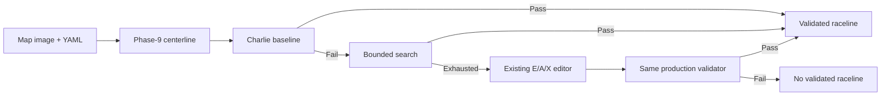

# centerline_tools: offline raceline workbench and ROS publisher

## 1. Summary and document map

Generate and validate a raceline offline with the existing Phase-9 centerline
pipeline and Charlie's deterministic global optimizer. No simulator or vehicle
stack is launched. The workbench offers baseline → bounded tuning → manual E/A/X
fallback; every validated candidate passes the same production validator. An explicit
experimental export keeps failed checks visible and cannot become production-valid.

**Race-day quick start:** open the canonical container and run
`python3 raceline_workbench.py <map_image> <map.yaml>` from this package.
A working display opens the GUI automatically. Use `--headless --auto-search` for
bounded automated retries without a window. Each invocation creates a fresh session;
`--open-session` safely resumes one.
Copyable fixture/manual commands and output-discovery instructions live in the
[operational reference](../docs/ROBORACER_OPERATIONAL_COMMAND_REFERENCE.md#11-offline-raceline-workbench).
The later sections document retained legacy generators and the ROS publisher;
legacy preview/export filenames alone do not establish production acceptance.

**Quick links:** [workbench flow](#flow-and-result-states) · [GUI/actions](#race-day-interface) ·
[tuning versus hard limits](#search-settings-versus-hard-constraints) ·
[common validator/manual fallback](#one-production-validator-and-manual-fallback) ·
[outputs](#outputs-and-ownership) · [downstream selection](#selection-and-downstream-handoff) ·
[legacy optimizer](#6-global-raceline-optimization) · [ROS publisher](#9-basic-ros-run-publish-final-smoothed-raceline) ·
[CSV schema](#16-csv-format-consumed-by-ros-publisher).

<!-- table-of-contents:start -->
**Table of contents**

- [1. Summary and document map](#1-summary-and-document-map)
- [2. Workbench contract](#2-workbench-contract)
- [3. Legacy generator outputs](#3-legacy-generator-outputs)
- [4. Package placement](#4-package-placement)
- [5. Legacy offline generation](#5-legacy-offline-generation)
- [6. Global raceline optimization](#6-global-raceline-optimization)
- [7. Reproducible obstacle maps](#7-reproducible-obstacle-maps)
- [8. Build](#8-build)
- [9. Basic ROS run: publish final smoothed raceline](#9-basic-ros-run-publish-final-smoothed-raceline)
- [10. Run directly from source-tree CSV](#10-run-directly-from-source-tree-csv)
- [11. Publish the centerline instead, if needed](#11-publish-the-centerline-instead-if-needed)
- [12. Reverse the published direction](#12-reverse-the-published-direction)
- [13. RViz2 setup](#13-rviz2-setup)
- [14. Useful launch parameters](#14-useful-launch-parameters)
- [15. Useful checks](#15-useful-checks)
- [16. CSV format consumed by ROS publisher](#16-csv-format-consumed-by-ros-publisher)
- [17. Notes](#17-notes)
<!-- table-of-contents:end -->

## 2. Workbench contract

### Flow and result states



| Result | Meaning / next action |
| --- | --- |
| `AUTO_PASS` | Baseline satisfies every gate; use the validated output. |
| `AUTO_TUNING_REQUIRED` | Baseline failed; inspect quantitative reasons and run/offer search. |
| `AUTO_TUNED_PASS` | First fully validated search/tuned candidate; use the validated output. |
| `AUTO_SEARCH_EXHAUSTED` | No valid candidate in the bounded schedule; manual editing remains available. This is **not proof of physical infeasibility**. |
| `MANUAL_PASS` | Explicit manual candidate passed the identical production gates. |
| `NO_VALIDATED_RACELINE` | Manual validation or input/centerline/workflow failed; no current promoted output. |

### Race-day interface

The GUI has three steps: **Generate automatically → Review and adjust → Select /
export**. Run the deterministic baseline with **Generate Raceline**, then **Try
More Settings** if it fails. Browse candidates with Previous/Next/Best and compare
the baseline overlay. **Try My Settings** applies the three readable presets;
**Edit Path Manually** reuses E/A/X. Solves are synchronous: RUNNING is shown and
action buttons are disabled until completion. This may pause window interaction;
a responsive background solver is not implemented.

| Main control | Meaning |
| --- | --- |
| Corner Cutting | More favors a shorter cornering line; peak curvature can increase. |
| Steering Smoothness | More penalizes rapid curvature and lateral transitions. |
| Optimization Detail | Fine reduces optimizer spacing, adding freedom and computation. |

Balanced resets the control's parameters to the session baseline. **Preset Values**
shows every choice's exact backend numbers (including session-specific Balanced
values), plus the current trial settings. Presets live in
[workbench YAML](config/raceline_workbench.yaml), affect only explicit trials and
never change automatic search or vehicle limits. Effects interact and are not
monotonic. **Advanced Tuning / Diagnostics** exposes all six parameters with units,
ranges, effect explanations, baseline reset, candidate-ID preview and revalidation.
Every numerical field supports both dragging and typed input; invalid/nonfinite or
out-of-range input retains the previous value. Draft edits take effect only with
**Apply Settings & Close**; Cancel discards them. The candidate actions are separate:
**Show Candidate** changes the preview only; **Check File** reruns the validator.
Neither action solves, exports or selects downstream.
Mouse-wheel zoom is centred on the map cursor (same factors as E/A/X); toolbar
pan/zoom remains available. Viewport is retained when status/candidates refresh;
**Fit Map** restores the complete path view. The main screen shows corridor/steering
failures, achieved versus required clearance,
peak curvature and equivalent turning radius; offending map/curvature samples are
highlighted. It also displays the exact active CSV, separately from the previewed trial.
**Finish / Exit** shows saved files and selection status; **Save Validated & Exit**
rechecks/exports/selects a passing candidate before closing. **Exit — keep saved
files** preserves all existing artifacts; it cannot promote a failed candidate.

GUI selection is default when the existing Tk/Matplotlib display probe succeeds.
Without a working display, the CLI runs headless and states that fact; `--gui`
requires a display. Exit `0` means a validated output **or an explicitly exported
experimental selection** exists, not that every candidate is production-valid.
Exit `1` means no usable export; `2` means preflight/action failure. Always inspect
selection status. A failed centerline stage prevents optimization and retains its log.

### Search settings versus HARD constraints

The initial profile is the unchanged
[Charlie configuration](config/global_raceline_optimizer.yaml).
[Workbench YAML](config/raceline_workbench.yaml) owns editable ranges and an ordered
schedule, not new optimizer mathematics. All candidates start from the resolved
baseline; solver tolerances and non-search fields stay fixed.

| SEARCH setting | Meaning | Default editable range |
| --- | --- | --- |
| `optimization_spacing_m` | Station spacing; finer adds freedom/computation | 0.05–0.20 m |
| `maximum_lateral_offset_m` | Search cap; actual bounds remain clipped by safe corridor | 0.15–1.50 m |
| `path_length_weight` | Preference for a shorter/corner-cutting line | 0.03–0.25 |
| `curvature_rate_weight` | Penalize rapid curvature change | 0.005–0.08 |
| `offset_slope_weight` | Penalize rapid lateral transitions | 0.001–0.03 |
| `comfortable_curvature_inv_m` | Soft curvature objective, **not** steering limit | 0.70–1.00 1/m |

Phase A has eight named spacing/search-cap trials. Phase B has eight named
soft-objective trials at 0.10 m spacing / 1.50 m cap. There is no random or Cartesian
sweep. Duplicate profiles are skipped; at most `search.maximum_candidates` trials
(default 16 **in addition to baseline**) run, stopping at first PASS. Repeated
Auto Search button presses do not extend that session's budget. Preset/advanced trials
are explicit human trials, not part of the automatic budget.

**HARD envelope:** baseline `safety_margin_m=0.25 m`,
`maximum_curvature_inv_m=1.082 1/m`, `validation_step_m=0.005 m`.
The curvature limit represents the existing 20.6-degree / 0.33 m / 0.95 envelope;
automatic search never changes these values. Advanced `vehicle_profile` overrides
are explicit and recorded. The Advanced window now exposes wall margin and hard
curvature as separate drag/text fields; `advanced_vehicle_limits` in YAML defines
input bounds (0.05–1.00 m margin, 0.25–2.00 1/m curvature), **not hardware-qualified
safe limits**. Applying changed limits requires confirmation and creates a fresh
session with a saved `session_profile.yaml`, no candidates and no active selection.
Generate/validate again under that declared profile; original exports retain their
original validation. Auto-search never changes these values. Custom-profile
validation is labelled explicitly and does not establish actual steering ability
or onboard suitability. Dense validation spacing remains fixed in this GUI.
For each map, effective erosion is margin + resolution/√2 (0.285355 m for
0.25 m margin at 0.05 m/pixel); reports compute it rather than hardcoding it.

The explicit [IFAC workbench fixture](config/raceline_workbench_ifac.yaml) retains
the existing reviewed IFAC optimizer profile (0.30 m margin and its solver
settings) plus recorded 0.94 centerline coverage threshold. It does not relax
curvature or dense-validation limits. The generic strict optimizer can hit its
iteration limit on IFAC; the generic 0.98 traversal threshold can reject its
branched skeleton. The tool does not silently identify maps and switch profiles.

### One production validator and manual fallback

`diagnose_production_path` in
[Charlie's backend](centerline_tools/global_raceline_optimizer.py) checks finite,
nondegenerate geometry; the entire exported polyline including seam at the dense
step inside the same eroded corridor; no self-intersection; intended direction;
**absolute maximum** curvature; and curvature/curvature-rate RMS no worse than the
centerline at common spacing `max(output_spacing_m, 0.05 m)` with the existing
`1e-6` relative numerical tolerance for RMS. The hard curvature gate has no
excess tolerance. Automatic candidates additionally require all three solver
stages to converge. Clearance is conservative nearest-grid-cell evidence, not
exact distance to the continuous wall.

Nonconverged/invalid candidates retain diagnostics and previews only. Ranking
prefers fully valid, corridor-safe/curvature-invalid, curvature-safe/corridor-invalid,
multiple-gate failure, then solver/topology failure; gaps break ties. Ranking never
changes validity. A diagnostic reference preview after an early search failure is
explicitly labelled, never promoted as an optimized result.

The workbench reuses the existing manual editor's E/A/X groups, longitudinal
indices, signed lateral offsets, direction flip and saved sessions. In workbench
mode, it uses the production corridor/max-curvature preview and labels Save as a
**candidate export**. The legacy 24-degree/p99 indication is not authoritative.
Zero-corner Save is blocked in workbench mode, preventing silent centerline fallback.
After Save, the workbench reloads the CSV and runs all common gates; explicit reverse
direction is recorded and checked against the reversed reference. A saved external
manual CSV can be checked with `--manual-candidate` without a display. Standalone
legacy commands retain their behavior and are not the workbench acceptance path.

### Outputs and ownership

Default home: `centerline_output/workbench/<map-stem>-<UTC>-<input-hash>-<unique-id>/`.
A new invocation never silently reuses another session. It does show the most
recent verified export with matching YAML/image hashes as a **previous-export
preview**, including status and source profile, even before new centerline generation.
**Open Previous Session** explicitly resumes it. Discovery scans session folders;
there is no hidden global latest file or automatic downstream selection. A broken
latest export is reported rather than silently replaced by an older one. Different
map hashes cannot share the preview. A supplied `--output-dir`
must be new/empty; **`--open-session <directory>`** restores candidates/settings
and the active selection. Without a directory value, `--open-session` offers a
simple existing Tk file picker for the saved report. Reopening checks map identity,
Phase-9 generation/settings/artifact hashes, stored candidate/output hashes and
selected evidence; stale/changed inputs fail. V1 sessions can be reopened if the
solver/centerline profile still matches; adding UI presets alone is not a solver
change. Earlier reports are archived before updated provenance is written.
Current Phase 9 requires zero origin yaw and `negate: 0`. Map inputs are not overwritten.

| Artifact | Purpose |
| --- | --- |
| `centerline_points_smooth.csv`, `drivable_region.npy`, `centerline_metadata.yaml` | Centerline/reference inputs and map hashes |
| `workbench_inputs.yaml`, `phase9_provenance.yaml` | Ownership and exact qualified reuse contract |
| `candidate/<id>/candidate.csv`, `diagnostics.yaml`, `preview.png` | Unpromoted candidates, solver stages, gate/gap evidence and overlay |
| `raceline_points_optimized.csv`, `raceline_validation.yaml` | Validated pair; a generation PASS does not itself select it downstream |
| `raceline_points_experimental.csv`, `experimental_validation.yaml` | Explicit failed-candidate export with limitations; never validated |
| `session_profile.yaml` (explicit limit-edit session only) | Resolved settings for the deliberately changed offline envelope |
| `selected_raceline.yaml` | Intentional per-session selection, exact asset/evidence hashes and direction |
| `raceline_workbench_report.yaml` | Stable result, resolved settings/hashes, attempted/best candidate, final validation, environment and output hashes |
| `preview.png`, `centerline_generation.log`, `manual_editor.log`, `manual/` | Latest visual diagnostics, detailed logs and resumable unvalidated edits |
| `diagnostics/previous_report_<hash>.yaml`, `candidate/previous_validated_<hash>/` | Earlier report/output history; trials leave an active selection unchanged |

Generated workbench sessions are Git-ignored and excluded from package installation.
Reviewed durable assets still require explicit approval. The original two-argument
`run_centerline_and_optimized_raceline.py` now delegates to this same isolated
workbench; extra workbench options are accepted. Other legacy commands below
continue to use their shared output location.

### Selection and downstream handoff

**Select / Export Validated** rechecks all common gates against the on-disk geometry.
**Export Experimental** requires a confirmation displaying failed checks, copies
exact candidate bytes into its distinct filename and records parameters, source,
map/envelope hashes and limitations. Reference-only previews cannot be exported
as optimizer results. Experimental output is for deliberate inspection/simulation;
it never launches or enables control and is not validated for onboard deployment.

Both GUI and CLI write the same session-owned `selected_raceline.yaml` (format 1).
Its `selection` contains candidate ID, generator, `validated`/`experimental` status,
absolute CSV and validation-report paths/hashes, map YAML/image paths/hashes,
vehicle-constraint values/hash, custom-profile flag, and direction. Direction is `csv`: manual reversal is
already present in exported coordinates; `candidate_direction` preserves that history.
No hidden global latest file exists. Trying another candidate leaves the selection
unchanged until another explicit selection action.

[Selection resolver](centerline_tools/raceline_selection.py) verifies assets/schema,
evidence consistency and optional caller-map identity without ROS side effects.
Missing/changed files fail rather than fall back. Experimental input requires
`--allow-experimental`. The source-tree helper prints summary/JSON or shell-quoted
arguments for the existing runner, full-stack or standalone-publisher APIs.
The simulation runner also accepts `--selected-raceline` instead of its existing
CSV/direction inputs, retains explicit scenario/map preflight and snapshots the
manifest/validation into a recorded run. It does not infer a simulator configuration
from the manifest. Recommended onboard operation accepts **validated** selections
only, via existing explicit paths; no actuator/deployment workflow is added.
See the [operational reference](../docs/ROBORACER_OPERATIONAL_COMMAND_REFERENCE.md#11-offline-raceline-workbench)
for all copyable commands and exact artifact access.

## 3. Legacy generator outputs

After running the offline generator, the important files are in `centerline_output/`:

- `centerline_points_smooth.csv`: final smoothed centerline with geometry fields
- `raceline_points_smooth.csv`: final smoothed raceline with the same geometry fields
- `raceline_offset_field.csv`: legacy x/y-only raceline export kept for older debug scripts
- `debug_raceline_offset_field.png`: raceline overlay debug image
- `debug_raceline_curvature.png`: raceline curvature debug plot

Both `centerline_points_smooth.csv` and `raceline_points_smooth.csv` use this format:

```text
index,x,y,yaw,curvature,curvature_abs
```

## 4. Package placement

Recommended simulator workspace location:

```bash
/sim_ws/src/centerline_tools
```

## 5. Legacy offline generation

From the package root:

```bash
cd /sim_ws/src/centerline_tools
python3 generate_centerline.py Spielberg_map.png Spielberg_map.yaml
```

For another map, replace the image and YAML names:

```bash
python3 generate_centerline.py <map_image.pgm-or-png> <map.yaml>
```

Expected final raceline output:

```bash
centerline_output/raceline_points_smooth.csv
```

Quick check:

```bash
head centerline_output/raceline_points_smooth.csv
```

The header should be:

```text
index,x,y,yaw,curvature,curvature_abs
```

## 6. Global raceline optimization

The global optimizer consumes the Phase-9 centerline, selected drivable-region
mask, and ROS map metadata. It optimizes one lateral offset at each uniformly
sampled centerline station. The objective is solved in three deterministic
stages: segment/length initialization, minimum curvature, and curvature-rate
smoothing. The default length and lateral-transition weights balance minimum
curvature with an outside-inside-outside corner line; the offset-to-center term
remains small. All objective terms wrap across the lap seam.

Legal lateral offsets are ray-cast from the centerline through an eroded
drivable-region mask. Before saving, the tool densely validates the complete
loop for corridor clearance, self-intersection, direction, finite geometry,
and maximum curvature. A failed solve or validation does not replace the final
CSV/report pair.

Run the optimizer against the active Spielberg artifact set:

```bash
cd /sim_ws/src/centerline_tools
python3 optimize_global_raceline.py \
  --centerline output_backup/V0_reward_ppo_speed_spielberg_1000k_20260612/centerline_points_smooth.csv \
  --drivable-mask output_backup/V0_reward_ppo_speed_spielberg_1000k_20260612/drivable_region.npy \
  --map-yaml Spielberg_map.yaml \
  --config config/global_raceline_optimizer.yaml \
  --baseline-raceline output_backup/V0_reward_ppo_speed_spielberg_1000k_20260612/raceline_points_smooth.csv \
  --output output_backup/V0_reward_ppo_speed_spielberg_1000k_20260612/raceline_points_optimized.csv \
  --report output_backup/V0_reward_ppo_speed_spielberg_1000k_20260612/raceline_points_optimized_validation.yaml
```

`--baseline-raceline` records a common-spacing comparison with the manually
tuned line; it is not used as an optimization input. For another map, keep the
centerline, mask, and map YAML from the same generation run.

To also render the optional comparison plot, install the package dependencies
with `rosdep` and add:

```bash
--debug-plot output_backup/V0_reward_ppo_speed_spielberg_1000k_20260612/debug_global_raceline_optimization.png
```

The default output name is `raceline_points_optimized.csv`. The optimizer never
replaces its source centerline or a comparison raceline. The reviewed Spielberg
artifact under `output_backup/V0_reward_ppo_speed_spielberg_1000k_20260612/`
is retained for explicit selection; IFAC is the current default; files generated at
other paths remain inactive until selected explicitly.

Generate a fresh centerline and optimized raceline in one command:

```bash
python3 run_centerline_and_optimized_raceline.py Spielberg_map.png Spielberg_map.yaml
```

The centerline extractor normally requires the ordered loop to cover at least
98% of the pruned skeleton. A scanned map with verified short medial-axis
branches can use an explicit one-run threshold without weakening the default:

```bash
CENTERLINE_MIN_ORDERED_LOOP_COVERAGE_RATIO=0.94 \
  python3 centerline_reference_generator.py <map_image> <map.yaml>
```

The resolved threshold is written to `centerline_metadata.yaml`. The generated
loop must still be closed and pass the traversal step checks, and the global
optimizer independently validates clearance, self-intersection, direction,
curvature, and smoothness before saving its output.

The validation YAML records input hashes, resolved parameters, each solver
stage, numerical-library versions, common-spacing before/after metrics, and
dense safety results. Its clearance metric is a conservative nearest-grid-cell
sample, not an exact Euclidean distance to the continuous wall boundary. The
debug plot overlays the centerline, optional baseline, and optimized result.
The shipped `1.082 1/m` curvature gate matches the runtime 20.6-degree steering
limit, 0.33 m wheelbase, and 0.95 safety factor; change it only together with
the vehicle/controller envelope.

The checked-in optimized IFAC Roboracer CSV is the default global path for
`f1 auto` and `full_stack_sim_launch.py`. To A/B test another generated CSV,
pass an explicit launch override. To select the retained Spielberg line:

```bash
ros2 launch oudtra_driver_bringup full_stack_sim_launch.py \
  raceline_csv_path:=/sim_ws/src/centerline_tools/output_backup/V0_reward_ppo_speed_spielberg_1000k_20260612/raceline_points_smooth.csv
```

The selected racing-line CSV is published as both `/raceline_waypoints` and
`/raceline_path`. The local path generator consumes the former and the planner
uses the latter as its sole Frenet frame, so no separate runtime centerline CSV
or direction setting is required.

The current Phase-9 centerline generator assumes a zero map-origin yaw. The
optimizer's coordinate conversion supports rotated maps, but a rotated-map
centerline must come from a generator that applies the same origin rotation.

## 7. Reproducible obstacle maps

`obstacle_creation_tool.py` supports both its graphical editor and a batch
workflow. Batch mode applies the same track-boundary, obstacle-size, raster,
overlap, and global-clearance checks as the editor. It additionally requires a
raceline and rejects any obstacle that does not block the configured physical
vehicle envelope.

Generate the nine-obstacle Spielberg key-turn map from the same
centerline/raceline pair used by the simulator autonomy launch:

```bash
cd /sim_ws/src/centerline_tools
python3 obstacle_creation_tool.py Spielberg_map.png Spielberg_map.yaml \
  --centerline output_backup/V0_reward_ppo_speed_spielberg_1000k_20260612/centerline_points_smooth.csv \
  --raceline output_backup/V0_reward_ppo_speed_spielberg_1000k_20260612/raceline_points_smooth.csv \
  --raceline-blocking-clearance-m 0.24 \
  --batch-spec obstacle_specs/spielberg_key_turns.yaml \
  --output-dir obstacle_output/spielberg_key_turns
```

The output includes the ROS map image and YAML, a clearance CSV, and a debug
overlay showing the centerline, active raceline, obstacle labels, boundary
gaps, and obstacle-to-raceline clearance. The batch command fails instead of
silently saving if any placement is invalid or does not block the raceline
envelope.

To place obstacles manually, omit `--batch-spec` and `--raceline`; the existing
graphical workflow opens and the original input map remains unchanged.

## 8. Build

```bash
cd /sim_ws
source /opt/ros/foxy/setup.bash
colcon build --packages-select centerline_tools
source install/setup.bash
```

Because legacy files directly under `centerline_output/` are installed into the package share directory, rebuild after regenerating the offline raceline if you want the installed launch default to use the newest CSV.

## 9. Basic ROS run: publish final smoothed raceline

Recommended launch command:

```bash
ros2 launch centerline_tools raceline_publisher.launch.py
```

A compatibility launch file also remains available:

```bash
ros2 launch centerline_tools centerline_publisher.launch.py
```

Both launch files start the same ROS node:

```text
/raceline_publisher
```

By default, the launch file loads:

```bash
centerline_output/raceline_points_smooth.csv
```

relative to the installed package share directory.

Published outputs:

- `nav_msgs/Path` on `/raceline_path`
- `visualization_msgs/MarkerArray` on `/raceline_markers`
- `std_msgs/Float64MultiArray` on `/raceline_waypoints`

## 10. Run directly from source-tree CSV

Use this if you regenerated the CSV in the source tree but have not rebuilt yet:

```bash
ros2 launch centerline_tools raceline_publisher.launch.py \
  csv_path:=/sim_ws/src/centerline_tools/centerline_output/raceline_points_smooth.csv \
  frame_id:=map \
  use_sim_time:=true
```

## 11. Publish the centerline instead, if needed

The same publisher can still publish the centerline CSV when explicitly requested:

```bash
ros2 launch centerline_tools raceline_publisher.launch.py \
  csv_path:=centerline_output/centerline_points_smooth.csv
```

If you do this, the topic names still remain `/raceline_*` unless you override them manually.

## 12. Reverse the published direction

If the arrows point opposite to the desired driving direction:

```bash
ros2 launch centerline_tools raceline_publisher.launch.py \
  direction:=reverse
```

Valid direction values:

- `csv` / `normal`: use the CSV order
- `reverse`: reverse the loaded path before publishing

The node recomputes yaw and curvature after the final direction choice, so the Path orientation, direction arrows, and waypoint rows stay consistent.

## 13. RViz2 setup

In RViz2:

1. Set `Fixed Frame` to `map`.
2. Add a `Path` display:
   - Topic: `/raceline_path`
3. Add a `MarkerArray` display:
   - Topic: `/raceline_markers`
   - Reliability Policy: `Reliable`
   - Durability Policy: `Transient Local`
   - History Policy: `Keep Last`
   - Depth: `1` or higher

Marker meaning:

- green `LINE_STRIP`: published raceline shape
- red sphere: start point / first CSV point
- yellow arrows: sampled published direction
- optional blue spheres: sampled waypoint points, disabled by default

## 14. Useful launch parameters

```bash
csv_path:=centerline_output/raceline_points_smooth.csv
frame_id:=map
path_topic:=/raceline_path
marker_topic:=/raceline_markers
waypoints_topic:=/raceline_waypoints
direction:=csv
publish_rate_hz:=1.0
publish_start_marker:=true
publish_direction_arrows:=true
direction_arrow_stride:=40
direction_arrow_length:=0.35
publish_point_markers:=false
point_marker_stride:=10
use_sim_time:=true
```

For denser direction arrows:

```bash
ros2 launch centerline_tools raceline_publisher.launch.py \
  direction_arrow_stride:=20 \
  direction_arrow_length:=0.25
```

For a cleaner display with no arrows:

```bash
ros2 launch centerline_tools raceline_publisher.launch.py \
  publish_direction_arrows:=false
```

## 15. Useful checks

```bash
ros2 node list | grep raceline
ros2 topic list | grep raceline
ros2 topic echo /raceline_path --once
ros2 topic echo /raceline_markers --once
ros2 topic echo /raceline_waypoints --once
ros2 param list /raceline_publisher
ros2 param get /raceline_publisher csv_path
```

Expected active ROS API:

```text
/raceline_publisher
/raceline_path
/raceline_markers
/raceline_waypoints
```

## 16. CSV format consumed by ROS publisher

Required columns:

- `index`
- `x`
- `y`

Recommended geometry columns:

- `yaw`
- `curvature`
- `curvature_abs`

The publisher accepts missing geometry columns, but it recomputes `yaw`, `curvature`, and `curvature_abs` at startup anyway. This keeps the published Path orientation and waypoint rows consistent with the selected `direction` parameter.

## 17. Notes

- The node loads the CSV once at startup, then republishes the static data at a low wall-time rate.
- Transient-local QoS is used so RViz can still receive markers if it starts after the publisher.
- If the loop is not closed within the configured tolerance, the node can append the first point to the end automatically.
- The default marker display is intentionally simple: line + start marker + direction arrows.
