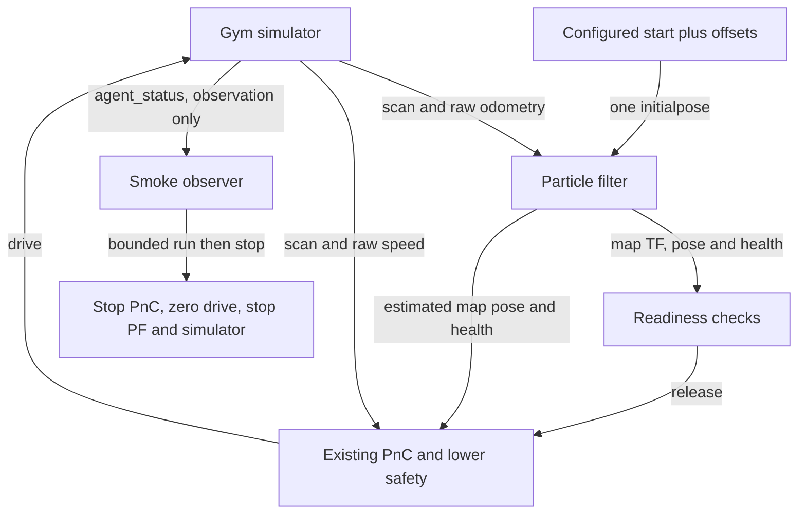
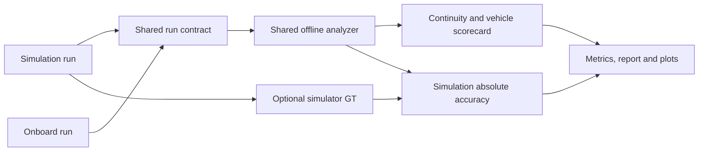

# Localization simulation and shared offline evaluation

## 1. How to use this document

This document explains the localization-enabled simulation architecture, readiness
contract, recorded evidence, metric definitions, and interpretation limits. Use the
[operational command reference](ROBORACER_OPERATIONAL_COMMAND_REFERENCE.md) for
copyable commands and [development environment](DEVELOPMENT_ENVIRONMENT.md) for
container/workspace setup. Start with the workflow below, then use sections 3–5
for recording, artifacts, and evaluation semantics.

**Start here:** [current operator commands](ROBORACER_OPERATIONAL_COMMAND_REFERENCE.md#current-operator-workflow)
for doing a run; this guide explains why it works and what its results mean.
**Quick links:** [startup/readiness](#2-closed-loop-localization-workflow) ·
[recording](#3-recording-a-simulation-evaluation-run) · [deliverables](#4-preserved-run-artifacts-and-deliverables) ·
[metric definitions](#53-scorecard-definitions) · [comparison](#54-compare-completed-runs) ·
[onboard evidence](#55-onboard-recording-contract) · [plots/examples](#56-plots-and-validation-artifacts).

<!-- table-of-contents:start -->
**Table of contents**

- [1. How to use this document](#1-how-to-use-this-document)
- [2. Closed-loop localization workflow](#2-closed-loop-localization-workflow)
  - [2.1 Reproduction](#21-reproduction)
  - [2.2 Readiness and acceptance](#22-readiness-and-acceptance)
  - [2.3 Interfaces and evaluation profile](#23-interfaces-and-evaluation-profile)
  - [2.4 Adding a simulation track](#24-adding-a-simulation-track)
  - [2.5 Headless execution and timing evidence](#25-headless-execution-and-timing-evidence)
- [3. Recording a simulation evaluation run](#3-recording-a-simulation-evaluation-run)
  - [3.1 Recording purpose and lifecycle](#31-recording-purpose-and-lifecycle)
- [4. Preserved run artifacts and deliverables](#4-preserved-run-artifacts-and-deliverables)
  - [4.1 Recorded signal contract](#41-recorded-signal-contract)
- [5. Shared simulation/onboard evaluation](#5-shared-simulationonboard-evaluation)
  - [5.1 Purpose and evidence model](#51-purpose-and-evidence-model)
  - [5.2 Input and output contract](#52-input-and-output-contract)
  - [5.3 Scorecard definitions](#53-scorecard-definitions)
  - [5.4 Compare completed runs](#54-compare-completed-runs)
  - [Matched reference-section comparison](#matched-reference-section-comparison)
  - [5.5 Onboard recording contract](#55-onboard-recording-contract)
  - [5.6 Plots and validation artifacts](#56-plots-and-validation-artifacts)

<!-- table-of-contents:end -->

## 2. Closed-loop localization workflow

The opt-in localization evaluation workflow starts the existing Gym simulator, PF,
and full PnC stack, initializes PF once from the selected simulator start, and
checks 15 seconds of autonomous motion. The runner receives the scenario, simulator
config, PF map, raceline and direction explicitly. A separate integration overlay
fixes clock/frame integration and disables simulator-GT-dependent recovery.
PASS proves short-run startup and motion, not localization accuracy or racing robustness.
The perfect-localization and onboard defaults are unchanged. The shared offline
scorecard also analyzes onboard data without GT; see
[shared evaluation](#5-shared-simulationonboard-evaluation) for metrics, limitations
and comparison commands.

### 2.1 Reproduction

Choose [A1 interactive simulation](ROBORACER_OPERATIONAL_COMMAND_REFERENCE.md#13-a1--interactive-tempo-simulation-in-three-terminals)
for three persistent terminals, human initialization/readiness and manual stopping;
there is no automatic evaluation recorder. A1's optional raw bag lacks the complete
analysis contract. Choose [A2 timed recording](ROBORACER_OPERATIONAL_COMMAND_REFERENCE.md#12-tempo-coffee-experimental-pfpnc-and-low-speed-comparison)
for bounded readiness/motion checks, one-shot pose, bag/metadata and automatic cleanup.
A1 PF reads `localization_eval_sim.yaml` directly. A1 and onboard PnC select
`track:=tempo_coffee`, resolving the installed, Git-maintained CSV/manifest/map;
A2 supplies that same curated manifest through its existing `--selected-raceline`.
Raw workbench sessions are not deployment dependencies. Its PnC-only adapter,
`full_stack_localization_sim_launch.py`, verifies the explicit selected-raceline
manifest and internally reuses A2's restricted simulation/speed merge. It removes
its temporary settings on shutdown; no path is handed between terminals. The
adapter starts neither simulator nor PF, initializes neither, and records no run.
Do not combine A1/A2 in one ROS domain.

Exit 0 plus smoke JSON PASS establishes startup and bounded motion only. RViz is
not a pass/fail source. The human authorizes experimental Tempo 008 for initial
controlled integration, without changing production curvature limits. Onboard uses
its own explicit-map PF launch, standard frame/clock/config chain and passive
recorder; see [B onboard commands](ROBORACER_OPERATIONAL_COMMAND_REFERENCE.md#5-onboard-stack-and-passive-measurement).
Actual deployment, stationary car checks and driving remain human-executed.

### 2.2 Readiness and acceptance

Each startup stage has `--startup-timeout-sec` (default 60); motion acquisition has
`--motion-timeout-sec` (default 15). No fixed startup sleeps are used.

1. Receive scan, raw odometry, and passive simulator status.
2. Start PF and wait for estimates and a matched initial-pose reader.
3. Send one `/initialpose` (`PoseWithCovarianceStamped`, `map` frame), using YAML
   `sx`, `sy`, `stheta` plus `--x-offset-m`, `--y-offset-m`, `--yaw-offset-rad`.
4. Receive more health updates than the configured manual-reset grace plus five;
   require a finite normalized map pose, usable PF health, and map-to-laser TF.
5. Start full PnC; verify lower-safety PF odometry, disabled GT gate, enabled
   arbitration PF-health gate, and absence of control/localization GT subscribers.
6. Require nonzero final command and actual speed, plus over 0.2 m displacement.
   During the configured interval, reject loss of required message flow, motion
   stalls longer than two seconds, lack of physical progress over two seconds,
   and critical child-process exits. Verify owned process groups exit on cleanup.

PF has no explicit initialization acknowledgement. Post-publication updates and
health provide operational readiness, not a pose-accuracy assertion. The runner
never repeatedly resets PF and does not subscribe GT to generate initialization.
Manual RViz `2D Pose Estimate` remains available in the original manual workflow;
do not manually reset PF during the automated smoke run.

### 2.3 Interfaces and evaluation profile

`oudtra_driver_bringup/config/localization_eval_sim.yaml` is an explicit sparse
simulation-integration overlay:

- Wall time throughout: the current Gym bridge publishes wall timestamps, no `/clock`.
- PF frame names have no leading slash; lower safety consumes `/pf/pose/odom`
  in `map`, matching raceline direction geometry. PF still consumes raw odometry.
- Planner uses the base profile's 0.40 s bounded scan-time TF wait instead of
  the perfect-localization adapter's 0.05 s. No latest-TF substitution is introduced.
- PF health remains required by arbitration. Wrong-way checks remain enabled.
- `enable_sim_reverse_swept_gate: false`; lower safety's GT topic points to an
  unused topic. Simulator truth is used only by the passive motion observer.

It deliberately contains no map, raceline, start pose, or IFAC-specific path. Those
belong to the selected track/scenario contract:

| Input | Ownership |
| --- | --- |
| Scenario ID | Human-readable identity recorded with the run. |
| Simulator config | Simulator map path/image extension and initial pose. |
| PF map YAML/image | Explicit map-server input; normally the same YAML/image used by the simulator. |
| Raceline CSV and direction | Static reference passed explicitly to PnC. |
| PF localize config | PF base configuration; it does not override an explicit `map_yaml`. |
| `localization_eval_sim.yaml` | Clock, frames, PF/PnC integration, PF-health gate and simulator-GT isolation. |

The existing `full_stack_sim_launch.py` accepts the integration overlay through its four
`*_platform_config` arguments. Its optional `use_sim_time` argument selects the
raceline publisher clock; the overlay selects the other node clocks. An empty
clock argument preserves the platform default. PF's `localize_sim_launch.py`
accepts `localize_config`, an explicit authoritative `map_yaml`, and optional
`parameter_overlay`, applied last to PF/map/lifecycle nodes. Omitting `map_yaml`
retains the legacy map name from the resolved runtime `localize_config`. The
maintained runner always supplies it explicitly and records all launch arguments.

Before launch, the runner parses every selected input, verifies the map image named
by each YAML, compares simulator/PF map metadata and image hashes, and validates
finite raceline `x`/`y` geometry. A mismatch fails before ROS processes start.
Recorded metadata preserves paths and SHA-256 hashes for the simulator config,
both map descriptions/images, raceline, PF config and evaluation overlay. IFAC is
the current validated fixture; it is not a semantic requirement of the runner.



GT-dependent reverse swept checks are disabled only in this profile. This short
check does not establish recovery performance, collision freedom, localization
accuracy, or suitability for competition deployment.

### 2.4 Adding a simulation track

Add the track image and map YAML, generate and validate its optimized raceline, and
create a simulator config containing the map path and start pose. Then run the same
workflow with a new scenario ID and explicit simulator config, map YAML, raceline
and direction. No Python or launch source change should normally be required.
Use the [operational command reference](ROBORACER_OPERATIONAL_COMMAND_REFERENCE.md)
for the maintained copyable command shape; geometric raceline validation remains
owned by the centerline/raceline tooling.

### 2.5 Headless execution and timing evidence

The automated runner now passes `use_rviz:=false` to the localization simulator
launch by default, so it runs without a display. Manual simulator launch retains
RViz by default; `--with-rviz` restores it for an interactive runner session.
The Gym bridge does not call its renderer in this workflow. PF visualization
computation is guarded by subscriber counts; PnC still publishes some diagnostic
markers, which are not part of the evaluation evidence. Visualization is for
observation, not benchmark acceptance.

For a completed recorded simulation run, `analyze_sim_timing.py` writes a separate
`timing.json` without changing `metrics.json` or the scorecard. Bag receive times
within `[RUNNING, EVALUATION_END)` give bridge-status, raw-odometry, PF-pose, and
final-drive rates, interarrival jitter, and wall-stamp-to-bag ages. `/scan` is not
recorded in the scorecard bag; its timing comes from the runner's passive callback.
The bridge publishes scan and agent status in the same timer callback, so the
recorded status rate is a source-publication proxy when the runner misses scans.
The PF map-to-base TF retains the last raw-odometry stamp; its age gives combined
input queue, PF work, and transport delay, not isolated PF compute time. The
simulation exposes no qualified physics clock or step counter, so real-time factor
is unavailable. Compare display, message transport, PF input age, and control
rates separately; wall-time execution is preserved.

## 3. Recording a simulation evaluation run

### 3.1 Recording purpose and lifecycle

Optional recording preserves the same smoke run as a nine-topic rosbag plus phase
and configuration metadata. A separate offline command produces a scorecard,
`metrics.json`, and applicable engineering plots after shutdown. Smoke completion,
recording validity, and analysis validity are distinct; no localization performance
thresholds are imposed.

Use the maintained [recorded-run command](ROBORACER_OPERATIONAL_COMMAND_REFERENCE.md#8-record-and-analyze-an-evaluation-run)
to capture source revisions, start the same closed-loop workflow, and analyze it
offline. The revision strings identify source history; they do not prove installed
binaries are current.

Use a new directory each time; existing directories are rejected. Exit 0 requires
both smoke PASS and successful recording. On failure, inspect the reason and logs;
partial data is retained. No evaluation interval exists if startup never reaches
RUNNING. The recorder is the only additional permitted passive GT subscriber.
Without `--record-dir`, the original smoke-only invocation remains supported.

After the runner exits, analysis reads the preserved bag directly without restarting
ROS nodes or replaying the bag. The operational reference owns the exact analysis
and repeatability commands.

`ANALYSIS PASS`/exit 0 means usable data was analyzed, not that accuracy is acceptable.
Missing essential data returns `ANALYSIS FAIL`/exit 1. Optional reference absence
produces `UNAVAILABLE_DATA` reference metrics and no reference plot. Onboard input
without GT is valid; absolute accuracy is `NOT_APPLICABLE`. Analysis requires the
sourced Foxy Python/message libraries, NumPy and Matplotlib already installed in
the canonical image; it does not require a live ROS graph. This Foxy image has no
`rosbag2_py`, so the analyzer reads uncompressed SQLite/CDR bags directly.

Open `oudtra_driver_bringup/runs/<run-id>/report.md` on the **host** to view the
scorecard and PNGs. The package is bind-mounted, so these are the same files.
Artifacts are ignored by Git:

```text
<run-id>/
  metadata.yaml       # revisions/state, phase timestamps, roles, settings, config hashes
  smoke_result.json
  rosbag/             # immutable raw SQLite/CDR record plus bag metadata
  config/             # copies of launched inputs, map and reference files
  logs/
  metrics.json
  report.md
  plots/              # GT/PF XY, position error, static reference vs GT
```

Reanalysis overwrites only generated analysis outputs. Preserve metadata/config and
bag together. Run the essential pytest command above after changes; its synthetic
CDR tests include known errors, angle wrap, gaps, reference segments, emergency
transitions, missing GT, and repeatable outputs. The shared schema and additional analysis commands are described below.

## 4. Preserved run artifacts and deliverables

Run data is written under the host checkout because `oudtra_driver_bringup` is
bind-mounted into the container. The container path and equivalent host path are:

```text
Container: /sim_ws/src/oudtra_driver_bringup/runs/<run-id>/
Host:      /home/mzhou/f1tenth_dev/oudtra_driver_bringup/runs/<run-id>/
```

The curated Tempo selection's local validation example is
`tempo_curated_track_a2_20261028/`: open `report.md`, `metrics.json` and `plots/`
there when the dataset is available locally. Its `metadata.yaml` and selection
snapshots retain map/reference/config hashes. It is ignored run evidence, not part
of a fresh Git clone; reproduce it using the A2 command guide.

Use a descriptive run ID such as `ifac_pf_closed_loop_localization_baseline_20260918T120000Z`; do not use a numeric-only directory name. For the current validated simulation example, open these files on the dev laptop:

```text
/home/mzhou/f1tenth_dev/oudtra_driver_bringup/runs/ifac_pf_closed_loop_smoothness_baseline_20260922T175959Z/report.md
/home/mzhou/f1tenth_dev/oudtra_driver_bringup/runs/ifac_pf_closed_loop_smoothness_baseline_20260922T175959Z/metrics.json
/home/mzhou/f1tenth_dev/oudtra_driver_bringup/runs/ifac_pf_closed_loop_smoothness_baseline_20260922T175959Z/plots/trajectory_xy.png
/home/mzhou/f1tenth_dev/oudtra_driver_bringup/runs/ifac_pf_closed_loop_smoothness_baseline_20260922T175959Z/plots/position_error.png
/home/mzhou/f1tenth_dev/oudtra_driver_bringup/runs/ifac_pf_closed_loop_smoothness_baseline_20260922T175959Z/plots/reference_trajectory.png
/home/mzhou/f1tenth_dev/oudtra_driver_bringup/runs/ifac_pf_closed_loop_smoothness_baseline_20260922T175959Z/plots/smoothness_oscillations.png
```

`report.md` is the human summary, `metrics.json` is the machine-readable result,
and `plots/` contains the generated figures. `metadata.yaml`, `config/`, `logs/`,
and `rosbag/` preserve provenance and raw evidence. The `runs/` directory is
intentionally ignored by Git; copy or archive a run explicitly if it must be
shared. From the host, list the latest deliverables with:

```bash
find /home/mzhou/f1tenth_dev/oudtra_driver_bringup/runs -maxdepth 3 \
  \( -name report.md -o -name metrics.json -o -name '*.png' \) -print
```

Detailed task handoffs live locally in Git-ignored `temporary_reports/NNN_<subject>.md`;
use its `INDEX.md` for chronology, original names and uncertainty. They are separate
from generated run deliverables and are not available in every clone. Lasting
outcomes belong in the project record or owning guide, not a committed report archive.

**November shared-metric review (offline only, 2026-11-11):** local ignored artifacts
are under `oudtra_driver_bringup/runs/tempo_shared_metrics_…_reanalyzed_20261111/`:
three `onboard_session{1,2,3}_motion_20261105` directories and
`sim_dependency_regression_20261107`. Session 3 is the primary onboard example.
The comparison is `tempo_shared_metrics_sim_vs_onboard_session3_review_20261111/`.
Open each `report.md` in Markdown preview; inspect `metrics.json` and linked
`plots/`, especially `pf_reference_trajectory.png`, `localization_health.png` and
`pose_increment_disagreement.png`. These local datasets are not supplied by a Git
clone. Original bags/reports remain in their original directories. The operational
guide owns commands to copy/reanalyze existing runs without overwriting them.

### 4.1 Recorded signal contract

`config/localization_recording.yaml` defines the semantic roles and topic/type
mapping, independent of control tuning. Record only this explicit list:

| Role | Topic | Interpretation |
| --- | --- | --- |
| Public estimated pose | `/pf/pose/odom` | PF map-frame base pose; timestamp is publication time. |
| Source-timed estimated pose | `/tf` | Analyze only `map -> ego_racecar/base_link`; identical PF pose stamped with input odometry time. |
| Localization health | `/pf/health` | Element 0: 1 GOOD, 2 DEGRADED, 3 INVALID; unstamped, bag receive time only. |
| Simulator truth/collision | `/simulator/agent_status` | `simulator/ego` true map/base XY/yaw and collision flag from Gym state. |
| Raw odometry | `/ego_racecar/odom` | PF input in its local odometry frame, not map GT; its body-twist `linear.x` and `angular.z` supply simulated forward-speed and yaw-rate evidence. |
| Static reference | `/raceline_path` | Recorded map-frame raceline; reliable/transient-local QoS. |
| Final command | `/drive` | Final speed/steering commanded into simulator. |
| Safety state | `/reactive_control_v2/lower_safety_status` | Exact `mode` value, including `EMERGENCY_STOP`. |
| Arbitration state | `/drive_arbitration_v2/status` | Selected mode, reasons, readiness context. |

No `/tf_static` is needed for direct map/base pose comparison. No scan, map topic,
particle cloud or visualization topics are recorded. Raw odometry, health, command
and arbitration support the shared consistency, availability and vehicle metrics
below; no PF-internal statistics are promoted to headline metrics. The public PF poses are cross-checked against source-timed TF values.

## 5. Shared simulation/onboard evaluation

### 5.1 Purpose and evidence model

**Milestone boundary (2026-11-20):** low-speed PF/PnC integration has simulation and
human-operated onboard evidence. A **standardized, hardware-validated onboard
measurement and sim/onboard comparison workflow is still to be established**.
The tools below support shared offline metrics and exploratory reference-section
analysis; they do not qualify missing deployment provenance, physical alignment or
unverified sensor semantics. The existing structured recorder remains software/mock
validated. See the [project milestone](PROJECT_RECORD.md#2026-11-20--ai-assisted-workflow-and-low-speed-localization-integration-milestone).

One offline analyzer accepts simulation and onboard bags. It generates the
same scorecard structure with explicit evidence and applicability on every metric.
GT enables absolute localization accuracy; onboard pose/odometry agreement is
**consistency, not accuracy**. Public-PF tracking is shared on both platforms; legacy tracking retains GT in simulation
and estimated map pose onboard; pace uses GT trajectory in simulation and local odometry onboard.
These different evidence sources are labelled and do not receive automatic deltas.
The passive onboard recorder now produces this same run-directory contract without
launching or mutating the vehicle stack. Tests and a controlled ROS graph validate
the software path. The November 5 raw bags are human-collected onboard evidence;
they do not establish hardware validation of the structured recorder. Use the
[Terminal 4 procedure](ROBORACER_OPERATIONAL_COMMAND_REFERENCE.md#5-onboard-stack-and-passive-measurement)
for maintained commands.

The existing smoke startup, control profile, recording topic set and PASS/FAIL
contract are unchanged. Analysis never feeds a localization or control node.



Simulation vehicle metrics also retain their labelled GT trajectory evidence.
No GT input is required for the onboard branch.

### 5.2 Input and output contract

The directory stays `metadata.yaml`, `rosbag/`, optional `config/` and `logs/`,
then generated `metrics.json`, `report.md`, `plots/`. Raw inputs are not rewritten.
Input metadata schema 1 is adapted for existing recorded runs; schema 2 is the
explicit shared contract. Output metrics use schema 2 (a deliberate JSON breaking
change from the original scalar/null fields). Existing simulation definitions remain.

Schema 2 metadata requires `platform: sim|onboard`, `roles`, and either existing
`phases` with RUNNING/EVALUATION_END wall/monotonic stamps or an explicit `interval`
with integer `start_wall_ns` and `end_wall_ns`. Explicit interval callers must ensure
source and bag times share that wall-clock domain. Optional `outcome.completed` is
boolean; legacy `smoke_result.result` is adapted. Optional startup phase events
SEND_INITIAL_POSE/LOCALIZATION_READY provide readiness timing. No readiness is
invented when events are absent. `run_id` preserves provenance; the directory name
provides the human artifact title, even when a legacy directory was renamed.

Roles configure ROS topic/type/frame and decoder fields. ROS libraries are needed
to decode CDR, but no running ROS nodes or bag replay are needed. Supported adapters:

| Role | Data / additional mapping |
| --- | --- |
| `estimated_pose` | `nav_msgs/msg/Odometry`, declared `frame`; source-stamped map/base pose |
| `source_pose` (optional legacy adapter) | `tf2_msgs/msg/TFMessage`, `parent`/`child`; takes precedence over public estimated pose and cross-checks pose values |
| `raw_odometry` | `nav_msgs/msg/Odometry`, local pose and declared `frame`; never treated as truth |
| `vehicle_state` | `nav_msgs/msg/Odometry` body twist; `velocity_frame: body`; `physical_time: true` only with verified physical source timing; `lateral_velocity_observed: true` required for lateral dynamics; `evidence` describes measurement/model provenance |
| `localization_health` | `std_msgs/msg/Float32MultiArray`, `index` (default 0), string-key `states` mapping; receive-time basis |
| `reference_path` | `nav_msgs/msg/Path`, declared map `frame`, unchanged ordered geometry; closure must be present as an actual final segment |
| `final_drive_command` | `ackermann_msgs/msg/AckermannDriveStamped`, source-stamped final speed/steering angle |
| `safety_status` | `diagnostic_msgs/msg/DiagnosticArray`, `status`, `state_key` (default mode), `emergency_state` (default EMERGENCY_STOP) |
| `control_status` | Same diagnostic adapter, plus explicit `autonomous_states` list |
| `ground_truth_pose` (optional) | Odometry with `frame`, or DiagnosticArray with `status`, `pose_keys` (default x_m/y_m/yaw_rad) |
| `collision_status` (optional) | DiagnosticArray with `status`, `collision_key` (default collision), true/false flag |

Multiple roles may decode the same topic without additional recording. A qualified
GT vehicle-state source can be mapped to `vehicle_state` through the supported
Odometry adapter; the current simulator diagnostic is not a physical-time velocity
source. Do not assert `physical_time: true` merely because a header exists.

Legacy role aliases (`health`, `truth`, `reference`, `command`, `safety`,
`arbitration`) and PF health/authority mapping remain supported. New algorithms
need not publish PF topics or duplicate pose TF. The existing simulation adapter
explicitly treats its odometry twist as body velocity with **unverified physical
timing**, despite the empty child frame. New onboard adapters must verify semantics.

Each metric has `status`, `value`, `unit`, `reason`, `evidence`, `method`,
`time_basis`, and optional coverage fraction. Statuses are:

- `AVAILABLE`: value supported by the stated evidence; partial observed counts
  retain coverage and lower-bound limitations.
- `NOT_APPLICABLE`: outside the evidence design, e.g. onboard absolute error without GT.
- `UNAVAILABLE_DATA`: applicable but absent/insufficient data or provenance.
- `ANALYSIS_ERROR`: malformed declared data or a violated type/frame/time contract.

Unavailable values are null, never zero. Missing optional data yields a partial
scorecard and exit 0. Malformed optional data marks affected metrics as errors,
retains unrelated results and exits 1. Invalid interval, unreadable bag or no usable
core estimated pose fails analysis. A PASS is data-analysis validity, not vehicle
performance acceptance. Counts with incomplete observation are lower bounds.

### 5.3 Scorecard definitions

Defaults are in `oudtra_driver_bringup/config/evaluation_analysis.yaml`. Effective
settings are written to every output. Existing bag `analysis` values override
package defaults; `--analysis-config <yaml>` overrides those; explicit timing CLI
options override the file. Thresholds define diagnostics only, not PF/PnC tuning.

Localization-specific terminology used by the scorecard:

| Term | Definition |
| --- | --- |
| Estimated map pose | PF estimate of vehicle position and heading in the global map frame. |
| Simulator ground truth (GT) | Gym's internal true vehicle pose, exposed only as passive evaluation evidence. |
| Raw odometry | Local motion/pose input to PF; it can drift and is not absolute truth. |
| Body frame | Coordinates fixed to the vehicle: x is forward and angular z is yaw rate. |
| Accuracy | Estimated global pose compared with independent GT. |
| Consistency | Agreement between PF and odometry motion; correlated evidence, not truth error. |
| Station / driven progress | Cumulative distance along the raw-odometry trajectory actually driven. It is a spatial coordinate, not publication time or raceline index. |
| Local trend | Slowly varying signal behavior fitted from the configured distance neighborhood. |
| Oscillation residual | Station-sampled signal minus its local trend. |
| Coverage | Fraction of relevant evidence that satisfied the metric's support and validity rules. |

The evaluation window is `[RUNNING, EVALUATION_END)`, excluding startup and shutdown.
Legacy wall and monotonic durations must agree within 0.05 s. Cleanup-only unstamped
zero commands outside this interval and its 0.20 s freshness history are excluded.
An unstamped command inside that interval is malformed, not silently retimestamped.

| Group | Metric definitions |
| --- | --- |
| Localization / Accuracy | Position [m] and absolute wrapped yaw [rad] p50/p95/max; source-pose sample weighting, GT interpolation across <=0.10 s, no extrapolation. Original simulation definitions retained. |
| Localization / Continuity | Flag adjacent pose increments exceeding `0.50 m + 10 m/s * dt` or `0.35 rad + 6 rad/s * dt`, only for dt <=0.20 s. Count transitions once; gaps are unknown. Largest position/yaw increment is reported regardless of flag. Resets may be legitimate discontinuities. |
| Localization / Availability | Union of valid `[receive_time, source_time + 0.50 s]` intervals, clipped to evaluation. Complement gives dropout intervals/count/longest [s], including boundary intervals. Readiness is initial-pose event to ready event [s]. Health states held <=0.50 s give durations/observed entries and unknown duration. `health_time_distribution` additionally reports GOOD/DEGRADED/INVALID/UNKNOWN durations and percentages of the entire evaluation interval, coverage and unknown-interval summaries. Fresh delivery is not GOOD quality; unknown time is never reassigned to GOOD. |
| Localization / Consistency | Relative SE(2) pose increments over 0.50 s windows every 0.10 s, rotated into each source's starting body frame. Translation residual [m] and wrapped yaw residual [rad] p50/p95/max; no interpolation across gaps >0.20 s. Event threshold: 0.30 m or 0.25 rad; count observed entries separately from initial/after-gap exceedances. |
| Vehicle / Robustness | Declared completion, collision observed (not impact count), emergency entries/active-at-start/uncertain entries. Narrow commanded-motion stall: autonomous state, non-emergency, abs(command speed) >=0.50 m/s and abs(vehicle speed) <=0.10 m/s continuously >=2 s. Each input must be <=0.20 s old. Duration includes the initial qualifying 2 s. This cannot detect an unintended zero command without an intent signal. |
| Vehicle / Tracking | New symmetric `pf_reference_position_deviation_m` and `pf_heading_to_reference_rad` use public `/pf/pose/odom` on both platforms. Legacy `static_reference_deviation_m` / `heading_to_reference_rad` retain GT in simulation and PF pose onboard. Distance to static reference segments [m] and absolute heading-to-segment-tangent [rad], p50/p95/max. Exclude degenerate segments and ambiguous tied headings. Changing reference is an error. Static reference deviation includes intentional obstacle avoidance. |
| Vehicle / Smoothness | Four distance-domain oscillation metrics: final speed command [m/s], final steering command [rad], vehicle forward speed [m/s], and vehicle yaw rate [rad/s]. Each reports RMS residual and P95 absolute residual around a local linear trend. Command rows describe requested behavior; vehicle-state rows describe simulated/measured response. Lower generally means less short-scale variation, without defining a performance threshold. |
| Vehicle / Pace | Sum trajectory segment lengths [m], with interpolated window endpoints and complete bounded-gap coverage; distance / elapsed evaluation seconds [m/s]. GT in sim, local odometry proxy onboard; no lap/sector timing yet. |

Smoothness first computes cumulative distance along the raw-odometry trajectory,
which provides the common sim/onboard driven-progress coordinate without using GT.
Each semantic signal is linearly resampled on a uniform 0.10 m station grid; raw
station gaps above 0.50 m remain unknown. At every supported station, a least-squares
local linear trend is fitted over a 1.00 m window. The signal minus that trend is the
oscillation residual. RMS describes typical residual amplitude; P95 means 95% of
absolute residuals are below that value. Coverage is the supported residual-grid
fraction of the driven interval. The method is deterministic for irregular source
sampling and does not use time derivatives or count chatter while the vehicle is
stationary. Settings are analysis-only and do not tune controllers.

Current simulation evidence maps final `/drive` speed and steering angle to the two
command metrics, and `/ego_racecar/odom` body-twist `linear.x` and `angular.z` to
forward-speed and yaw-rate metrics. The semantic roles allow future onboard mappings
to final Ackermann command, VESC-derived speed, and measured IMU yaw rate without
changing metric meaning. The optional analysis-only
[signal contract](../oudtra_driver_bringup/config/shared_evaluation_signals.yaml)
now maps onboard forward speed separately from gyro evidence. Existing combined
simulation `vehicle_state` remains unchanged. Optional `autonomy_command` adds
`autonomy_speed_command_oscillation` / `autonomy_steering_command_oscillation` from
upstream `/drive` on both platforms. Existing final-command metrics still use
`/drive` in sim and mux `/ackermann_cmd` onboard; they are different command-chain
locations. Neither commanded steering nor servo-command echo is physical feedback.

**Interpreting tracking and quality:** PF tracking describes where localization
believes the car is relative to the static reference. Sim GT tracking describes
where the simulator actually put the car. PF-versus-GT accuracy is a third,
independent calculation. All use explicit evidence labels; static-reference
avoidance can increase tracking deviation without a controller defect. Consistency
retains its 0.50 s body-relative SE(2) calculation and 0.30 m / 0.25 rad event
thresholds; the two-panel plot shows position and yaw disagreement. Agreement with
odometry is correlated evidence, never proof of absolute accuracy.

**Split response qualification:** `forward_speed` declares m/s, an observed odometry
frame/child body frame, and body-forward semantics. `yaw_rate` is a separate Imu
adapter requiring explicitly VERIFIED units, body axis/sign, bias and timestamp
qualification, nonempty observed body frame, z axis, sign, and finite bias in rad/s.
Explicit deg/s conversion is supported only with that qualification; values are
never used to guess units. Physical derivative qualification remains separate.
Unknown qualification produces UNAVAILABLE_DATA; malformed numeric/frame/time data
produces ANALYSIS_ERROR. Raw gyro ranges, observed frames and receive ages remain
available as diagnostics without claiming body-yaw units.

The inspected VESC source (`f1tenth_system` 5a46e19, VESC 196404e) passes firmware
gyro fields through unchanged, has a deg/s comment, stamps on driver receipt and
leaves the Imu frame empty. The November 5 bags also have empty IMU frame IDs.
Their units/mounting/sign/bias are **not qualified**: onboard yaw oscillation stays
unavailable. ERPM-derived `/odom` forward speed is an estimate, not independent
truth; `/odom.angular.z` is a bicycle-model result using commanded steering.
No replacement with model yaw is made.

Physical acceleration, jerk, and lateral acceleration remain secondary diagnostics.
When qualified evidence exists, they use a centered quadratic fit
`v(t+u)=c0+c1*u+c2*u²` over 0.50 s windows on a 0.10 s time grid: longitudinal
acceleration = c1 [m/s²], jerk = 2*c2 [m/s³], and lateral acceleration is
`d(v_y)/dt + v_x*r` [m/s²]. At least five unique samples, support >=0.40 s spanning
both halves, no gaps >0.10 s, and windows wholly inside evaluation are required.
They remain unavailable when timing or body-state evidence is insufficient; no
slip-free or wall-time substitute is silently used.

The legacy simulator advances fixed physics steps but stamps publications with wall
time. Therefore physical acceleration/jerk and lateral dynamics are **unavailable**
on this baseline. `/drive` acceleration/jerk/rate fields are unset zeros, not
measurements. The distance-domain command and body-twist oscillation metrics remain
usable, as does the commanded-motion stall metric.
Noisy or sparse data is rejected by support/gap rules; no missing interval is filled
with invented zero motion. Pose/odometry consistency is correlated evidence because
localization may consume the same odometry.

### 5.4 Compare completed runs

Use the maintained [offline comparison command](ROBORACER_OPERATIONAL_COMMAND_REFERENCE.md#10-compare-two-analyzed-runs)
after both source runs have successful schema-2 analysis. The comparison itself
uses plain Python/JSON, no ROS imports or live graph.

Output is `report.md` and `comparison.json` in the explicit separate output directory.
Never use a run directory as comparison output. Repeating the command deterministically
regenerates comparison outputs. Existing schema-1 outputs must be reanalyzed first.

For verified comparability, metadata may declare `comparison_identity` with
`scenario_id`, `reference_sha256`, `algorithm_id`, `algorithm_config_sha256`.
Use platform-independent algorithm/config identity, not a whole launch-profile hash;
platform adapters differ. Never invent values to unlock deltas. Existing revisions
and configuration hashes remain visible as provenance. Unknown legacy identity
suppresses deltas with a reason.

Rows align by semantic name; values/applicability remain side by side. Deltas are
right minus left (availability in percentage points), only for matching known
identity, settings, method, evidence, units and time basis. Incomplete coverage and
unequal-duration cumulative counts/distances suppress deltas. GT versus estimated
tracking has different evidence and receives no delta. Booleans/nested event summaries
are displayed without numerical differences. There is no composite score or causal
sim-versus-onboard performance claim.

### Matched reference-section comparison

The optional offline `compare_matched_sections.py` extension produces a **matched-section
exploratory comparison**, alongside an unchanged strict provenance-qualified comparison.
Use the [operational reference](ROBORACER_OPERATIONAL_COMMAND_REFERENCE.md#matched-reference-section-review)
for commands. Original inputs/reports are preserved. Cropped bag copies use new explicit
interval metadata and the existing analyzer, not duplicated metric mathematics.
Parent-run completion is retained as provenance, never inherited as section completion.

Matching uses public estimated map pose on both platforms and equal ordered, closed
recorded raceline geometry/direction (absolute coordinate tolerance 1e-9 m). It projects
onto segments, unwraps station continuously within bounded source gaps, and selects the
first fully covered traversal from station 0 by default. Selection never inspects health.
A partial initial traversal, subsequent laps and excluded samples are accounted for.
Nearby branches unresolved by geometry/continuity, large station jumps, excessive reverse
progress and pose gaps break coverage; no lap count is inferred across such breaks.
Small non-increasing station observations are omitted only from the first-crossing
station/time interpolation, counted explicitly, and retained in all interval metrics.

**Coordinates remain distinct:** reference station `s` is distance along the static
raceline. Existing smoothness driven progress remains cumulative raw-odometry trajectory
distance. The common reference-station grid is only for spatial waveform display;
headline metrics retain their original sample/time weighting and units. Different
speeds/publication patterns therefore still affect sample-weighted distributions.
The first 0.5 s cannot produce a complete in-section consistency window; plot gaps
and per-signal grid coverage are explicit, never zero-filled.

Default tolerances live in
[matched_section_analysis.yaml](../oudtra_driver_bringup/config/matched_section_analysis.yaml):
0.20 s maximum pose gap, 0.75 m projection distance, 0.03 m near-tie distance,
0.50 m distinct-branch station separation, 4 m/s station-change bound plus 0.20 m
slack, 0.15 m local reverse tolerance, 0.10 m station display spacing and 0.50 m
maximum station interpolation gap. These qualify offline association, not vehicle
capability or controller tuning. Matching rejects settings that are nonpositive or
unknown; section length must be positive and no longer than the recorded loop.

Exploratory metric subtraction requires AVAILABLE results, matching method/unit/time
basis/evidence and at least 95% metric support; effective shared analysis settings
must match. It is labelled `EXPLORATORY_UNVERIFIED_DEPLOYMENT`, never certified.
Reported health fractions, differently sourced Gym/ERPM response, missing onboard GT,
unqualified gyro and differing command stages receive observations only. The strict
comparator still applies its original identity/evidence gates independently.

The November 12 example matches one 11.279 m reference traversal, using Session 3's
reviewed 7.2–64.8 s raw-bag interval and a fresh headless Tempo run. It preserves
DEGRADED events in the selected interval; later INVALID events remain in the full-input
scorecard. Simulator GT independently checks PF alignment after selection; it never
selects the interval or feeds control/localization. This is neither physical section
truth onboard nor a controlled simulator-fidelity result. The matching output includes
section intervals, excluded/projection samples, coverage, recorded waveforms, metric
classifications, cropped scorecards, strict comparison and plots. Local artifact names
and paths are in the operational guide; datasets remain ignored and are not in a clone.

The matched report starts its figure section with two spatial views:
`plots/trajectory_xy.png` overlays simulator PF, onboard PF, the recorded raceline
and simulator GT with equal map axes; `plots/trajectory_map.png` separates those
traces into three panels over the captured simulation occupancy map. Dark pixels
show mapped obstacles/boundaries, light gray unknown space and white mapped free
space, interpreted with the map YAML thresholds, resolution and origin (including
yaw). Map/image hashes are checked before rendering; absent/mismatched snapshots
leave the map-free view and an explicit reason instead of silently using current
assets. No translation/rotation is fitted to the traces. Start/end markers identify
sample endpoints. Historical onboard map identity and its actual driven trajectory
remain unverified: the onboard line is a localization estimate, not ground truth.
Direction arrows follow the ordered raceline and each chronological PF/GT trace,
not measured onboard velocity vectors.
Use the map-free plot for detailed differences and the wider map panels for circuit
context before interpreting the station-domain scorecards.

`plots/pf_health_positions.png` adds the spatial quality context: full onboard
window and matched traversal on the captured map, full-window receive time versus
raceline station to separate repeated visits, and matched PF reference deviation
colored by reported quality. GOOD is green/circle, DEGRADED amber/triangle, INVALID
red/X, and UNKNOWN purple/plus (missing or stale health). INVALID markers are drawn
last where laps overlap. The unstamped health stream is associated causally using
the latest published state at each pose's bag-receive time, at most the existing
`max_status_gap_sec` old; no future state or position interpolation is used. This
is approximate association, not calibrated confidence or absolute accuracy. Legend
counts are pose samples, not the scorecard's time-normalized health fractions.
No position is assigned during missing-pose gaps. Exact associations and reasons
for unavailable station projection are inspectable in `pf_health_positions.json`.

`plots/pf_reference_deviation_positions.png` is a separate continuous-color view
of **PF-believed reference-position deviation**, reusing the existing nearest-polyline
position-error calculation. Full simulation and onboard scorecards show their entire
evaluation window beside PF tracking; the comparison shows the matched intervals
side by side. One distance scale [m] is shared across the four views of each pair.
Sparse gray spokes connect estimated positions to their nearest reference points;
black arrows show ordered raceline direction. Larger deviations are drawn last where
laps overlap. Map obstacles/boundaries provide context, not measured wall clearance,
a production safe corridor or independent onboard truth. The background requires the
same hash-verified captured simulation map as the trajectory views. PF health uses
categorical colors in its **separate** figure; neither view measures absolute onboard
localization accuracy. `pf_reference_deviation_positions.json` preserves displayed
samples and the common scale; metric tables/formulas are unchanged.

The optional `explain_pf_health.py` addendum places the same full-window spatial
quality view beside each onboard health timeline. It reads all nine recorded PF
health fields and executes the pinned monitor's unchanged classification logic
with an explicitly supplied **reference** onboard YAML. A scenario table separates
scan-quality thresholds, hysteresis/recovery, the prolonged-DEGRADED watchdog,
hard uncertainty/motion rejection and missing evidence. Counters are reconstructed;
only published diagnostics/status are observed. Unknown prehistory and gaps require
a new healthy anchor. Matching a status sequence establishes compatibility with
that reference profile, **not** historical deployed parameter identity, calibrated
confidence, independent localization failure or health-equivalent sim/onboard deltas.
`pf_health_explanation.json` preserves inputs/hashes, thresholds, replay coverage and
transition evidence; `plots/pf_health_trigger_evidence.png` shows the mechanism over
time. The human explanation starts with state meanings (DEGRADED scan disagreement,
INVALID prolonged-warning escalation, UNKNOWN missing evidence) before optional
threshold/replay details. `plots/pf_health_failure_modes.png` separates instantaneous
scan-check failures, improved evidence awaiting recovery, timeout-related INVALID
episodes and missing health into four map/raceline panels. These are evidence and
monitor-mechanism categories, not diagnosed physical failure causes; categories can
overlap. Causal associations, counts and missing intervals are inspectable in
`pf_health_failure_modes.json`. Missing-pose intervals receive no invented location.
`plots/pf_spread_quality_map.png` uses **three aligned side-by-side maps**:
particle spread alone (continuous meter scale), reported quality alone (categorical
colors), and warning explanation alone (the existing reason colors). Identical map
limits and pose samples support comparison without combining two visual encodings
in one marker. The scalar spread is `sqrt(weighted covariance xx + yy)` from
`/pf/health[4]`, not pose error, yaw spread or a calibrated confidence radius.
The common spread scale is 0–0.25 m across sessions; UNKNOWN has no fresh value.
`plots/pf_spread_quality_relationships.png` and `pf_spread_quality.json` preserve
the existing distributions, qualified correlations and causal pairing. Constant/
insufficient pairs remain unavailable; updates are autocorrelated and not causal
or controlled comparison evidence.

The matched-report renderer also adds `plots/raceline_gt_pf_overlay.png` to each
full simulation report: black dashed reference, green simulator truth and blue
dotted PF estimate, with equal axes and direction arrows. This separates actual
simulated tracking from localization disagreement without fitting trajectories.
`plots/heading_analysis.png` / `heading_analysis.json` in full runs and
`plots/heading_comparison.png` / `heading_comparison.json` in matched comparisons
reuse existing wrapped-heading/reference errors and gap-limited shortest-arc GT
alignment. Degrees are a presentation conversion; scorecard values remain radians.
Reference headings use the nearest unambiguous ordered-segment tangent; tied
headings stay missing. Wrap crossings and evidence gaps are broken in plotted lines.
PF/GT heading error is simulation-only localization evidence; PF/reference heading
deviation is believed tracking on both platforms; GT/reference is actual simulated
tracking. Reverse/avoidance behavior can increase reference deviation without
localization failure. No onboard IMU heading/yaw-rate qualification is implied.
Full-run tables read existing scorecards; station-domain comparisons are exploratory
and retain all provenance/delta gates. Subsequent analyzer report regeneration keeps
these optional presentation fragments; new heading/trajectory plots are produced by
the maintained matched-comparison renderer from preserved inputs.
Existing scorecard values remain unchanged. Commands are maintained in the
[matched-section procedure](ROBORACER_OPERATIONAL_COMMAND_REFERENCE.md#matched-reference-section-review).

#### Particle spread and tracking distance are different

Human reports label position tracking as **PF-estimated distance to raceline**
(the shortest estimated-map-position distance to the static reference), and
heading tracking as **heading difference from reference**. Existing JSON keys
containing `deviation` keep their historical meaning and remain compatible.
Neither quantity measures particle uncertainty or onboard truth error.

**PF particle spread** is the recorded `/pf/health[4]` scalar,
`sqrt(weighted var(x) + weighted var(y))`, in metres. It measures the cloud's
internal XY dispersion; a tight but biased cloud can have large truth error.
It is not a calibrated confidence radius, yaw uncertainty or a raceline distance.
Do not derive it from the legacy incorrectly packed Odometry covariance.

`evaluation_particle_spread.py` adds report-only full-window and matched-section
median/P95/max tables, conditioned on the same-message reported quality, plus
separate map casts and time/station views. `particle_spread.json` and
`particle_spread_comparison.json` preserve the exact evidence. Statistics are
health-message-sampled; map associations use the latest received health within
0.5 s, without filling gaps. The comparison reuses the existing common station
grid and first-crossing time mapping. No new certified difference is produced:
historical health thresholds and deployed identity remain unverified. Missing
spread is UNAVAILABLE_DATA, never zero. Spread/quality views use a shared
0–0.25 m color scale (over-range values remain in statistics).

#### Control-mode review and readable figures

Full run reports now include **Control selection, PF quality and particle spread**.
`evaluation_control_plots.py`, invoked by the maintained matched-comparison renderer,
reads the configured `control_status`, `safety_status` and `localization_health`
roles. In the current stack, `/drive_arbitration_v2/status` reports selected mode
RACELINE/REACTIVE/STOP/WAITING and a reason; lower-safety status is a separate layer.
Neither proves physical motion or onboard mux/actuator authority.

`plots/control_mode_map.png`, `lower_safety_mode_map.png`,
`control_pf_quality_map.png` and `particle_spread_map.png` are separate
full-size views with identical PF positions/limits. Direction arrows follow the
recorded reference. Diamonds mark located selected-mode changes, without inventing
locations during pose gaps. The uncertainty map uses internal particle spread;
tracking distance remains in the separate Tracking section. Neither is independent
onboard truth error or measured wall clearance.

`control_quality_timeline.png` separates selection, safety, PF quality and particle spread
on a shared **bag receive-time** axis. A transient safety change gets an event
marker, without stretching its duration. `control_mode_exposure.png` and the joint
mode/quality table quantify recorded exposure, not exact physical controller dwell.
The existing `max_status_gap_sec` limits causal holds; stale/missing states remain
UNKNOWN. Initial acquisition/reconnection is not counted as an observed switch.
`control_mode_analysis.json` preserves all source stamps, complete diagnostic
reasons, located/unlocated changes, conditional particle spreads (with legacy
tracking-distance fields retained) and both receive-time
and source-stamped summaries. Asynchronous status overlap is not proof of a gate
violation; logged reasons and controller-reported PF state are stronger evidence.

The inspected arbiter permits DEGRADED PF through its PF gate, while INVALID or
missing/stale health can prevent primary-chain selection when health is required.
Planner/guard/lower-safety conditions and recovery/latching also affect selection.
Conditional spread by mode does not establish cause, and current source does
not identify historical deployed configurations. No new certified delta or headline
metric is introduced.

For readability, human reports prefer full-size one-quantity maps with legends
outside the circuit. Separate `pf_particle_spread_map.png`, `pf_quality_only_map.png`
and `pf_warning_reason_map.png` replace the crowded default spread overview;
that overview remains an optional link. Heading comparisons use the wider
`heading_orientation_comparison.png` and `heading_deviation_comparison.png`, while
the previous four-panel overview is retained. Older PNGs remain local backups.

### 5.5 Onboard recording contract

`config/onboard_localization_recording.yaml` is the explicit no-GT contract used by
`record_onboard_localization.py`. The recorder is an observer: it creates
subscriptions and a rosbag process, but no vehicle/control publishers, parameter
clients, launch processes, or PF initialization events. A bounded preflight requires
the semantic scorecard topics plus scan, VESC telemetry, measured VESC IMU, the
servo-command echo, and TF streams. `/initialpose` is optional because an event may
occur before the recorder joins; start Terminal 4 before initialization when retaining
that event matters.

| Evidence | Current onboard source | Meaning |
| --- | --- | --- |
| Estimated pose / health | `/pf/pose/odom`, `/pf/health` | PF map pose and published PF health. |
| Raw odometry | `/odom` | VESC-derived local pose and forward speed; odometry is not GT. |
| Static reference | `/raceline_path` | Latched map-frame raceline used for tracking evidence. |
| Final drive command | `/ackermann_cmd` | Output selected by `ackermann_mux` and consumed by `ackermann_to_vesc_node`; shared plant-input command evidence. |
| Upstream autonomous command | `/drive` | Lower-safety/PnC output before teleop/lock mux selection; retained for debugging, not the shared final-command role. |
| Safety / authority | `/reactive_control_v2/lower_safety_status`, `/drive_arbitration_v2/status` | Emergency state and selected autonomous controller mode. |
| Forward vehicle speed | `/odom` `twist.linear.x` | Derived from measured VESC motor RPM by `vesc_to_odom`. |
| Raw gyro evidence | `/sensors/imu/raw` `angular_velocity.z` | Preserved separately; units/body axis/bias must be qualified before body-yaw metrics. |
| Steering evidence | `/sensors/servo_position_command` | VESC driver's echo of commanded servo position; it is not physical steering feedback. |

The analysis-only split contract supports ERPM-derived forward-speed oscillation
when progress coverage permits. It deliberately leaves the present raw IMU
unqualified, so body-yaw oscillation remains UNAVAILABLE_DATA. Stalls remain
unavailable without qualified vehicle-speed and actual command-authority evidence;
PnC arbitration mode alone does not establish the onboard mux source. Physical
acceleration/jerk need their own qualified timing and signal support. Continuity,
freshness, health distribution, consistency, public-PF tracking and upstream/final
command diagnostics do not require GT. Absolute accuracy is NOT_APPLICABLE without GT.

The structured recorder records platform/run/time, evaluation boundaries, main/PF/f1tenth_system
Git revision and clean/dirty/unknown state, contract/tool hashes, preflight topic/type/
frame observations, message counts, and supplied map/image/raceline/config hashes.
Missing paths or Git facts remain explicitly unknown. Bags and generated run data
stay under the Git-ignored `oudtra_driver_bringup/runs/` after transfer.

#### Importing a raw onboard bag

The simple Terminal 4 rosbag command records useful signals but does not create
evaluation metadata. `import_onboard_bag.py` verifies SQLite integrity, metadata
counts, CDR type declarations and raw hashes; copies the bag into a self-contained
run; applies the existing onboard semantic contract; and labels deployed revisions,
map/config identity, initialization, completion and unobserved collision evidence
as unknown. CDR/frame/value validation remains the analyzer's responsibility.
Nonempty WAL files and conflicting counts/types fail explicitly; originals are
never overwritten. No GT or combined measured vehicle-state adapter is invented.

The default interval is the whole raw recording. Explicit start/end offsets are
retrospective analyst-selected bounds, not operator RUNNING/STOP events. Keep the
entire bag so startup, stops and excluded boundaries remain inspectable. Raw run
inspection uses no live ROS graph. Comparison retains unknown-identity suppression;
observed path agreement does not prove the deployed PF map or parameter set.
See [transfer/import/analyze commands](ROBORACER_OPERATIONAL_COMMAND_REFERENCE.md#b5-dataset-transfer-and-offline-analysis).

### 5.6 Plots and validation artifacts

Keep GT/estimate XY and absolute-error time plots when GT exists, static-reference
XY when reference exists, one pose-increment disagreement time plot when supported,
and one four-panel smoothness-residual plot over driven progress when any headline
oscillation metric is available.
Onboard XY is labelled estimated pose; no absolute-error plot is fabricated.
All XY plots use equal scaling; time axes are elapsed evaluation seconds. The
smoothness plot shows residuals only: each evaluated signal minus its fitted local
trend. Zero follows the local trend; excursions show shorter-scale variation. Raw
signals and fitted trends are used by the analyzer but are not drawn.

Current host deliverables:

- Current simulation smoothness baseline: `oudtra_driver_bringup/runs/ifac_pf_closed_loop_smoothness_baseline_20260922T175959Z/`.
- **Synthetic, not onboard measurements:** `oudtra_driver_bringup/runs/synthetic_onboard_no_gt_contract_fixture/`.
- Schema/evidence comparison demonstration: `oudtra_driver_bringup/runs/sim_vs_synthetic_onboard_contract_comparison/`.

Open each directory's `report.md` in VS Code preview. Run scorecards link their
`plots/*.png`; machine results are `metrics.json` (runs) or `comparison.json`
(comparison). Prefix host paths with `/home/mzhou/f1tenth_dev/`; container equivalents
start `/sim_ws/src/`. These generated directories are Git-ignored and remain local.
